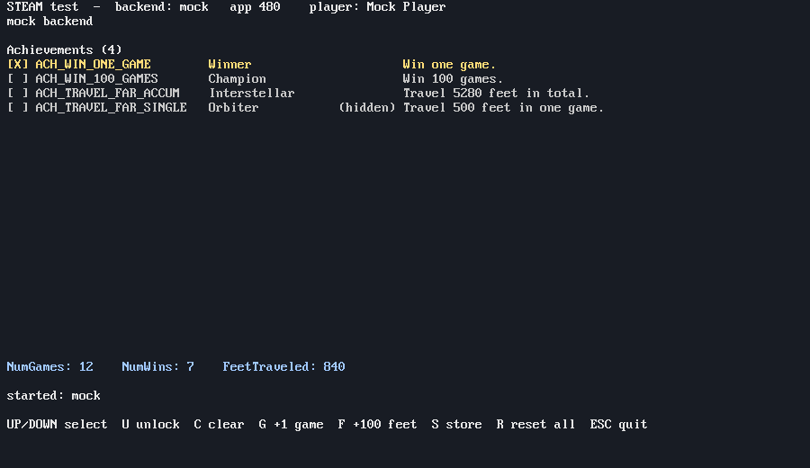
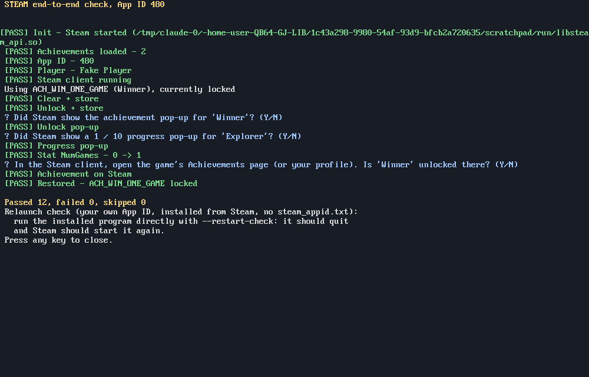

# QB64_GJ_LIB STEAM

Steam achievements and stats for QB64-PE games on Windows, macOS and Linux.

The library loads Valve's `steam_api` library **at runtime**. Nothing from
the Steamworks SDK is compiled in or kept in this repo, so no compiler flags,
SDK headers or import libraries are needed. You ship one file from the SDK
next to your game.

The library also has a **mock backend**: achievements and stats you define
are kept in memory, and optionally in a save file. It runs when Steam isn't
available (no library, Steam not running, no App ID), so the same game code
runs and can be tested anywhere: on a machine without Steam, in CI, or before
you have an App ID.



*`STEAM-TEST --mock`, which uses the achievements and stats of Valve's
Spacewar test app (App ID 480).*

## Quick start

```basic
'$INCLUDE:'STEAM/STEAM.BI'
' Only used when Steam isn't available:
STEAM_mock_achievement "ACH_WIN_ONE_GAME", "Winner", "Win one game.", 0
STEAM_mock_stat "NumGames"
STEAM_mock_file "mock-achievements.txt"

IF STEAM_restart_if_necessary%(480) THEN SYSTEM   ' release builds; your App ID
ok% = STEAM_init%(480)                            ' TRUE when a backend started
DO
    STEAM_update                                  ' once per frame
    IF player_won% THEN
        ok% = STEAM_set_stat_int%("NumGames", STEAM_stat_int&("NumGames") + 1)
        ok% = STEAM_unlock%("ACH_WIN_ONE_GAME")
        ok% = STEAM_store%                        ' send it; Steam shows its pop-up
    END IF
    ...
LOOP
STEAM_shutdown
'$INCLUDE:'STEAM/STEAM.BM'
```

`STEAM-EXAMPLE.BAS` is a complete version of this. `STEAM-TEST.BAS` lists every
achievement and lets you unlock, clear and store them.

## The Steam library file

Download the [Steamworks SDK](https://partner.steamgames.com/downloads/list).
You need a free Steamworks partner account. Copy the file for your platform
from `sdk/redistributable_bin/` to **the folder your compiled program is in**:

| Platform | File | From |
|---|---|---|
| Windows, 64-bit QB64-PE | `steam_api64.dll` | `redistributable_bin/win64/` |
| Windows, 32-bit QB64-PE | `steam_api.dll` | `redistributable_bin/` |
| macOS | `libsteam_api.dylib` | `redistributable_bin/osx/` |
| Linux, 64-bit | `libsteam_api.so` | `redistributable_bin/linux64/` |

Valve lets you ship this file with your game. Don't commit it to a public
repo.

The library searches for it in these places, in order:

1. a path set with `STEAM_library_path`,
2. the program's folder (on macOS also `../Frameworks/`, for an `.app` bundle),
3. the current folder,
4. the OS library path.

Any SDK from 1.5x onward works: the library tries both the current and the
older entry points (`SteamAPI_InitFlat`, then `SteamAPI_InitSafe`) and
interface versions (UserStats v013 / v012 / v011).

## End-to-end testing

The unit test and the mock show the library code is right. Only a real
Steam client shows that achievements reach Steam. There are two levels.



*`STEAM-TEST --e2e --yes`, here run against the stand-in library from the
unit test. With real Steam, the player is your Steam name and you answer the
questions yourself.*

### `STEAM-TEST` options

| Run | Does |
|---|---|
| `STEAM-TEST` | Interactive: lists achievements and stats. U unlocks, C clears, S stores, R resets. |
| `STEAM-TEST --selftest` | Prints what the library reports to the console. With the mock, it also checks a save-file round trip. |
| `STEAM-TEST --e2e` | Guided check against real Steam (see below). Exit code 0 when nothing failed. |
| `--app <id>` | App ID. Default 480. |
| `--ach <name>` / `--stat <name>` | The achievement and INT stat `--e2e` tests. The defaults are the first achievement, and `NumGames` for app 480 (any other app has no default stat, so the stat step is skipped). |
| `--yes` | `--e2e` answers its own questions with yes. Use it for unattended runs. |
| `--mock` | Use the mock backend. |
| `--restart-check` | Calls `STEAM_restart_if_necessary%` first. Use it to test the relaunch (Level 2). |

`--e2e` runs in the game window, because the Steam overlay draws its pop-ups
there. It does these steps:

1. Starts Steam. The mock is not allowed here, so if Steam doesn't start, the
   check fails at once and shows why.
2. Waits for the achievements to arrive, then checks the App ID, the player
   name, and that the Steam client is running.
3. Clears the test achievement, unlocks it again, and asks whether Steam's
   pop-up appeared.
4. Shows a progress pop-up on another locked achievement.
5. Adds 1 to the stat and reads it back.
6. Asks you to confirm the unlock on your Steam profile, which shows it reached
   Steam's servers.
7. **Puts everything back the way it was.**

Every step prints PASS, FAIL or SKIP to the window and to the console.

### Level 1: Spacewar (App ID 480), free

Valve's **Spacewar** app is free for every developer to test with. It already
has achievements (`ACH_WIN_ONE_GAME`, `ACH_WIN_100_GAMES`,
`ACH_TRAVEL_FAR_ACCUM`, `ACH_TRAVEL_FAR_SINGLE`) and stats (`NumGames`,
`NumWins`, `NumLosses`, `FeetTraveled`, `MaxFeetTraveled`).

1. Compile `STEAM-TEST.BAS`.
2. Next to the program, put the Steam library file for your OS, and a text
   file named `steam_appid.txt` that contains just `480`.
3. Start the Steam client and log in.
4. Run `STEAM-TEST --e2e` and answer its questions. The unlock appears under
   Spacewar on your profile until the last step removes it again.

This covers all of the library's real-Steam code: loading the library, init,
achievements, stats, storing, the overlay pop-ups and the server sync.

It can't cover these, which need your own App ID:

- your own achievement names and icons,
- installing and launching the game from your Steam library,
- the relaunch through Steam,
- uploading builds.

### Level 2: your own App ID

This tests the whole path a player takes. The game never has to be released:
an unreleased app stays visible only to your Steamworks team and to the
testers you give keys to.

1. **Join Steamworks** at [partner.steamgames.com](https://partner.steamgames.com/).
   You can sign up as an individual and use a name like *grymmjack* as the
   developer and publisher name on the store. Valve still needs your legal
   name, identity check, tax form and bank details.
2. **Pay the Steam Direct fee** (US$100 per app) to get an App ID. Valve only
   pays it back once the game earns US$1,000, so for a test-only app it is a
   cost. One App ID can be your test bed now and your real game later. The
   waiting period after paying only delays a public release, not testing.
3. **Define a few achievements and an INT stat** in *App Admin → Stats &
   Achievements*, with icons. **Publish** them.
4. **Set up SteamPipe**: one depot per OS, a private beta branch (for example
   `testing`), and launch options that run `STEAM-TEST` with these arguments:
   `--e2e --app <your id> --ach <name> --stat <name>`. Publish. The steps are
   in [steampipe/README.md](steampipe/README.md).
5. **Upload** `STEAM-TEST`, compiled on each OS. Don't ship a
   `steam_appid.txt`.

   ```sh
   cd STEAM/steampipe
   ./steam-build.sh --win ../STEAM-TEST.exe --linux ../STEAM-TEST --desc "e2e"
   ```

6. **Install it from Steam.** In the Steam client, open the game's
   *Properties → Betas*, pick your branch, install, and press *Play*. The
   `--e2e` check runs, now with your own achievements and the overlay that
   Steam injects at launch.
7. **Check the relaunch.** Run the installed program directly, from its
   install folder, with `--restart-check`. It should quit, and Steam should
   start it again with the launch options. This is what a player gets when
   they start the game outside Steam.
8. **Optionally, check other machines**: a Steam Deck or another Linux
   machine (the Steam Linux Runtime), and testers with keys from *Request
   Steam Product Keys*.

## API

All names are the API names from the Steamworks admin (for example
`ACH_WIN_ONE_GAME`). They are case-sensitive.

### Setup (call these before `STEAM_init%`)

| Routine | Does |
|---|---|
| `STEAM_mock_achievement api$, title$, desc$, hidden%` | Defines an achievement for the mock. Steam itself ignores this. |
| `STEAM_mock_stat api$` / `STEAM_mock_stat_float api$` | Defines an INT or FLOAT stat for the mock. |
| `STEAM_mock_file path$` | Save file for the mock: read by `STEAM_init%`, written by `STEAM_store%`. |
| `STEAM_use_mock` | Always use the mock and never try Steam. Setting the environment variable `GJ_STEAM_MOCK=1` does the same. |
| `STEAM_mock_fallback onoff%` | Whether to fall back to the mock when Steam can't start. Default TRUE. With FALSE, `STEAM_init%` returns FALSE instead. |
| `STEAM_library_path path$` | Exact path of the Steam library. |

### Lifecycle

| Routine | Returns / does |
|---|---|
| `STEAM_restart_if_necessary%(app_id&)` | TRUE when the game was started outside Steam and Steam is relaunching it: quit at once. FALSE when `steam_appid.txt` is present or there is no library. |
| `STEAM_init%(app_id&)` | TRUE when a backend started. Sets `SteamAppId` for this process unless Steam already did. Safe to call again. |
| `STEAM_update` | Lets Steam deliver its events. Call it once per frame. |
| `STEAM_shutdown` | Stops Steam. Changes not sent with `STEAM_store%` are lost. |

### Achievements

| Routine | Returns / does |
|---|---|
| `STEAM_unlock%(api$)` | Unlocks. TRUE on success. Steam shows its pop-up after `STEAM_store%`. |
| `STEAM_is_unlocked%(api$)` | TRUE when unlocked. |
| `STEAM_clear%(api$)` | Locks it again, for testing. Send with `STEAM_store%`. |
| `STEAM_progress%(api$, cur&, goal&)` | Shows Steam's "3 / 10" progress pop-up. It does **not** unlock; call `STEAM_unlock%` at the goal. |
| `STEAM_achievement_exists%(api$)` | TRUE when the name exists. Catches typos. |
| `STEAM_achievement_count&` | Number of achievements. |
| `STEAM_achievement_api$(i&)` | API name of achievement `0 .. count - 1`. |
| `STEAM_achievement_title$(api$)`, `STEAM_achievement_desc$(api$)` | Display texts, in the player's language. |
| `STEAM_achievement_hidden%(api$)` | TRUE for a secret achievement. |

### Stats

| Routine | Returns / does |
|---|---|
| `STEAM_stat_int&(api$)`, `STEAM_stat_float!(api$)` | Current value. 0 when unknown or the wrong type. |
| `STEAM_set_stat_int%(api$, v&)`, `STEAM_set_stat_float%(api$, v!)` | Sets the value. TRUE on success. Send with `STEAM_store%`. |
| `STEAM_store%` | Sends all changed stats and achievements to Steam, or writes the mock file. |
| `STEAM_reset_all%(with_achievements%)` | Resets all stats, and the achievements too when TRUE. Stored right away. For testing. |

### Info

| Routine | Returns |
|---|---|
| `STEAM_backend%` | `STEAM_BACKEND_NONE`, `STEAM_BACKEND_STEAMWORKS` or `STEAM_BACKEND_MOCK`. |
| `STEAM_backend_name$` | `"none"`, `"Steamworks"`, `"mock"`. |
| `STEAM_is_steam%` | TRUE when the real Steam backend is running. |
| `STEAM_status$` | What `STEAM_init%` did, in words, including why Steam didn't start. |
| `STEAM_app_id&` | The App ID in use. |
| `STEAM_player_name$` | The player's Steam name (`"Mock Player"` with the mock). |
| `STEAM_running%` | TRUE when the Steam client is running. |

## Tips

- **Call `STEAM_store%` after a batch of changes** (the end of a level, a
  win), not every frame. Steam rate-limits stores.
- Steam syncs stats during `STEAM_init%`. For the first few frames
  `STEAM_achievement_count&` can read 0. Keep calling `STEAM_update`.
- **AVGRATE stats** (Steamworks' third stat type) aren't wrapped. Use INT and
  FLOAT stats.
- Achievements can unlock automatically from a stat, using "progress stat" in
  the Steamworks admin. Then only the stat needs setting.
- The mock is strict like Steam: unlocking or setting a name you never defined
  fails. Define the mock achievements with the exact API names from the
  Steamworks admin, and typos show up before release.
- The mock save file is plain text (`A name 0|1`, `I name 12`,
  `F name 1.5`), so you can edit it to set up a test.
- The Steam overlay pop-up may only appear when the game is started from
  Steam, especially on Linux, where the overlay is injected at launch.
  Achievements still unlock without it.

## How it works

`steam.h` is compiled inline through `DECLARE LIBRARY "steam"`. It declares
its own function types for Steam's **flat C API**, the plain C functions
Valve exports for non-C++ languages: `SteamAPI_InitFlat`,
`SteamAPI_SteamUserStats_v013`, `SteamAPI_ISteamUserStats_SetAchievement`
and so on. It loads the library with `LoadLibrary` or `dlopen` and looks the
functions up by name.

Interface accessors carry a version number. The library tries the current
version first, then older ones, so it works with library files from older
SDKs. Older SDKs only fetch stats when asked, so when the library exports
`RequestCurrentStats` (UserStats v012 and older) it is called after init.

When Steam can't start, the mock takes over with the same calls. It uses a
`std::map` of the achievements and stats you defined, and a text save file.

`STEAM-NATIVE-TEST.cpp` tests `steam.h` without QB64 or Steam, against
`fake_steam_api.cpp`, a stand-in library that exports the same flat API:

```sh
cd STEAM
g++ -std=c++17 -Wall -shared -fPIC fake_steam_api.cpp -o libfake_steam_api.so
g++ -std=c++17 -Wall -shared -fPIC -DFAKE_OLD_SDK fake_steam_api.cpp -o libfake_steam_api_old.so
g++ -std=c++17 -Wall STEAM-NATIVE-TEST.cpp -o steamtest -ldl && ./steamtest
```

## Shipping on Steam (Steam Direct)

Steam **Greenlight**, the community vote that once decided which indie games
reached Steam, closed in 2017. **Steam Direct** replaced it. It has no SDK:
it is a sign-up and review process, and the only code you need is the
Steamworks library above. The steps below were current when this was
written. Check Valve's
[Steamworks documentation](https://partner.steamgames.com/doc/gettingstarted)
for changes.

1. **Join Steamworks.** Sign up at
   [partner.steamgames.com](https://partner.steamgames.com/). Valve verifies
   your identity, bank and tax details.
2. **Pay the Steam Direct fee.** It is US$100 per game, and Valve pays it back
   once the game earns US$1,000. You get an **App ID**. After paying, there is
   a waiting period before your first game can be released.
3. **Define achievements and stats.** In *App Admin → Stats & Achievements*:
   - Add the stats (INT or FLOAT) and achievements. Give each achievement an
     API name, display name, description, icons and the hidden flag.
   - **Click *Publish*** on the *Publish* tab. Until you publish, Steam doesn't
     know the new names and `STEAM_unlock%` returns FALSE.
4. **Use your App ID in the game.** Use it in `STEAM_init%` and
   `STEAM_restart_if_necessary%`. During development keep a
   `steam_appid.txt` with your App ID next to the program. **Don't ship
   `steam_appid.txt`**: without it, `STEAM_restart_if_necessary%` makes a copy
   started outside Steam relaunch through Steam.
5. **Lay out the build folder.** Put the compiled game, its data and the Steam
   library file for that platform together:

   ```text
   MyGame/
     MyGame.exe          (or MyGame on Linux / macOS)
     steam_api64.dll     (libsteam_api.so / libsteam_api.dylib)
     data/...
   ```

   - **Linux:** QB64-PE executables have no `$ORIGIN` rpath, which is why this
     library looks for `libsteam_api.so` in the program's own folder. In the
     Steamworks launch options, pick the **Steam Linux Runtime**, and test on
     a Steam Deck if you can.
   - **macOS:** put `libsteam_api.dylib` next to the executable, or in
     `Contents/Frameworks/` of an `.app` bundle. Sign and notarize the app so
     Gatekeeper lets it run.
6. **Upload with SteamPipe.** Create depots for each OS in *App Admin →
   SteamPipe*, then run [`steampipe/steam-build.sh`](steampipe/README.md).
   It stages the program, the Steam library and your data for each OS,
   writes the build script, and runs `steamcmd`. It also refuses to ship a
   `steam_appid.txt`. The upload goes live on a private beta branch; set the
   default branch live on the Steamworks site when you're ready.
7. **Store page and review.** Fill in the store page and publish it as
   *Coming Soon*. Valve requires it to be visible for a while before launch.
   Submit the store page and the build for Valve's review, then pick a release
   date.

### Release checklist

- [ ] Achievements and stats published in the Steamworks admin
- [ ] App ID in `STEAM_init%` and `STEAM_restart_if_necessary%`
- [ ] The right `steam_api` file for each OS next to the executable
- [ ] No `steam_appid.txt` and no mock save file in the shipped build
- [ ] Tested from a Steam beta branch: `STEAM-TEST --e2e` (or your game)
      passes, and `--restart-check` relaunches through Steam
- [ ] `STEAM_store%` after progress, and `STEAM_shutdown` on exit
